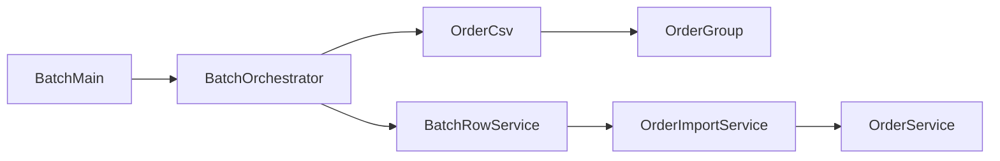
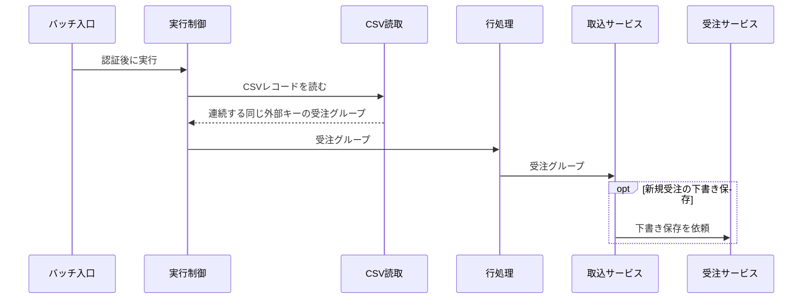

<!-- code-to-doc-artifact
{
  "schemaVersion": 1,
  "kind": "module-map",
  "scope": "受注 CSV の取り込み（バッチ入口から取込サービスまで。画面は対象外）",
  "status": "draft"
}
-->
# 受注 CSV 取り込みのモジュールマップ

## Scope

受注 CSV のバッチ入口から取込サービスによる下書き保存依頼までを対象とする。画面は対象外とする。

## Modules and responsibilities

- `BatchMain`: 認証処理の後に `BatchOrchestrator.execute` を呼び出す。 [[source:wholesale-batch/src/main/java/jp/co/tsubame/wholesale/batch/BatchMain.java#L30-L54]]
- `OrderCsv` と `OrderGroup`: 連続する同じ `external_key` の CSV レコードを1つの受注グループにまとめる。 [[source:wholesale-batch/src/main/java/jp/co/tsubame/wholesale/batch/OrderCsv.java#L38-L54]] [[source:wholesale-batch/src/main/java/jp/co/tsubame/wholesale/batch/OrderGroup.java#L108-L109]]
- `BatchOrchestrator` と `BatchRowService`: `import-orders` の受注グループを取込サービスに渡す。 [[source:wholesale-batch/src/main/java/jp/co/tsubame/wholesale/batch/BatchOrchestrator.java#L68-L78]] [[source:wholesale-batch/src/main/java/jp/co/tsubame/wholesale/batch/BatchOrchestrator.java#L136-L138]] [[source:wholesale-batch/src/main/java/jp/co/tsubame/wholesale/batch/RowTask.java#L28-L30]] [[source:wholesale-batch/src/main/java/jp/co/tsubame/wholesale/batch/service/BatchRowService.java#L45-L63]]
- `OrderGroup` の検証: 同じ商品コードが受注グループ内に複数回出現した場合、そのグループは却下される。 [[source:wholesale-batch/src/main/java/jp/co/tsubame/wholesale/batch/OrderGroup.java#L66-L83]] [[source:wholesale-batch/src/main/java/jp/co/tsubame/wholesale/batch/service/OrderImportService.java#L30-L34]] [[source:wholesale-batch/src/main/java/jp/co/tsubame/wholesale/batch/BatchOrchestrator.java#L136-L148]] [[source:wholesale-batch/src/main/java/jp/co/tsubame/wholesale/batch/service/BatchRunService.java#L72-L80]]
- `OrderImportService`: 新規受注の下書き保存を受注サービスに依頼する。 [[source:wholesale-batch/src/main/java/jp/co/tsubame/wholesale/batch/service/OrderImportService.java#L60-L74]]

## Dependencies

- バッチ入口は認証処理の後に実行制御を呼び出す。 [[source:wholesale-batch/src/main/java/jp/co/tsubame/wholesale/batch/BatchMain.java#L30-L54]]
- 実行制御は受注 CSV のグループを読み取り、行処理に渡す。 [[source:wholesale-batch/src/main/java/jp/co/tsubame/wholesale/batch/BatchOrchestrator.java#L68-L78]] [[source:wholesale-batch/src/main/java/jp/co/tsubame/wholesale/batch/BatchOrchestrator.java#L136-L138]]
- CSV 読取は受注グループを生成する。 [[source:wholesale-batch/src/main/java/jp/co/tsubame/wholesale/batch/OrderCsv.java#L38-L54]]
- 行処理は受注グループを取込サービスに渡す。 [[source:wholesale-batch/src/main/java/jp/co/tsubame/wholesale/batch/RowTask.java#L28-L30]] [[source:wholesale-batch/src/main/java/jp/co/tsubame/wholesale/batch/service/BatchRowService.java#L45-L63]]
- 取込サービスは新規受注の下書き保存を受注サービスに依頼する。 [[source:wholesale-batch/src/main/java/jp/co/tsubame/wholesale/batch/service/OrderImportService.java#L60-L74]]

## Data flow

- 連続する同じ `external_key` の CSV レコードは1つの受注グループになる。 [[source:wholesale-batch/src/main/java/jp/co/tsubame/wholesale/batch/OrderCsv.java#L38-L54]] [[source:wholesale-batch/src/main/java/jp/co/tsubame/wholesale/batch/OrderGroup.java#L108-L109]]
- 行処理の `import-orders` 分岐は受注グループを取込サービスに渡す。 [[source:wholesale-batch/src/main/java/jp/co/tsubame/wholesale/batch/BatchOrchestrator.java#L68-L78]] [[source:wholesale-batch/src/main/java/jp/co/tsubame/wholesale/batch/BatchOrchestrator.java#L136-L138]] [[source:wholesale-batch/src/main/java/jp/co/tsubame/wholesale/batch/RowTask.java#L28-L30]] [[source:wholesale-batch/src/main/java/jp/co/tsubame/wholesale/batch/service/BatchRowService.java#L45-L63]]
- 同じ商品コードが受注グループ内に複数回出現した場合、そのグループは却下される。 [[source:wholesale-batch/src/main/java/jp/co/tsubame/wholesale/batch/OrderGroup.java#L66-L83]] [[source:wholesale-batch/src/main/java/jp/co/tsubame/wholesale/batch/service/OrderImportService.java#L30-L34]] [[source:wholesale-batch/src/main/java/jp/co/tsubame/wholesale/batch/BatchOrchestrator.java#L136-L148]] [[source:wholesale-batch/src/main/java/jp/co/tsubame/wholesale/batch/service/BatchRunService.java#L72-L80]]
- 取込サービスは新規受注の下書き保存を受注サービスに依頼する。 [[source:wholesale-batch/src/main/java/jp/co/tsubame/wholesale/batch/service/OrderImportService.java#L60-L74]]

## Entry points

| Entry point | Type | Evidence |
|---|---|---|
| `import-orders` | バッチ | [[source:wholesale-batch/src/main/java/jp/co/tsubame/wholesale/batch/BatchMain.java#L30-L54]] [[source:wholesale-batch/src/main/java/jp/co/tsubame/wholesale/batch/BatchOrchestrator.java#L68-L78]] |

## Evidence

| Claim | Evidence |
|---|---|
| F-001: バッチ入口は認証処理の後に実行制御を呼び出す。 | [[source:wholesale-batch/src/main/java/jp/co/tsubame/wholesale/batch/BatchMain.java#L30-L54]] |
| F-002: 連続する同じ外部キーの CSV レコードを1つの受注グループにまとめる。 | [[source:wholesale-batch/src/main/java/jp/co/tsubame/wholesale/batch/OrderCsv.java#L38-L54]] [[source:wholesale-batch/src/main/java/jp/co/tsubame/wholesale/batch/OrderGroup.java#L108-L109]] |
| F-003: 行処理は受注グループを取込サービスに渡す。 | [[source:wholesale-batch/src/main/java/jp/co/tsubame/wholesale/batch/BatchOrchestrator.java#L68-L78]] [[source:wholesale-batch/src/main/java/jp/co/tsubame/wholesale/batch/BatchOrchestrator.java#L136-L138]] [[source:wholesale-batch/src/main/java/jp/co/tsubame/wholesale/batch/RowTask.java#L28-L30]] [[source:wholesale-batch/src/main/java/jp/co/tsubame/wholesale/batch/service/BatchRowService.java#L45-L63]] |
| F-004: 同じ商品コードが受注グループ内に複数回出現した場合、そのグループは却下される。 | [[source:wholesale-batch/src/main/java/jp/co/tsubame/wholesale/batch/OrderGroup.java#L66-L83]] [[source:wholesale-batch/src/main/java/jp/co/tsubame/wholesale/batch/service/OrderImportService.java#L30-L34]] [[source:wholesale-batch/src/main/java/jp/co/tsubame/wholesale/batch/BatchOrchestrator.java#L136-L148]] [[source:wholesale-batch/src/main/java/jp/co/tsubame/wholesale/batch/service/BatchRunService.java#L72-L80]] |
| F-005: 取込サービスは新規受注の下書き保存を受注サービスに依頼する。 | [[source:wholesale-batch/src/main/java/jp/co/tsubame/wholesale/batch/service/OrderImportService.java#L60-L74]] |

## Unknowns

- U-1: 商品コードが重複するグループの実行時の結果コードは未観察。 (next read: 許可を得た後、隔離されたデータベースで該当 CSV を投入し、`row-results` の結果コードを観察する)
